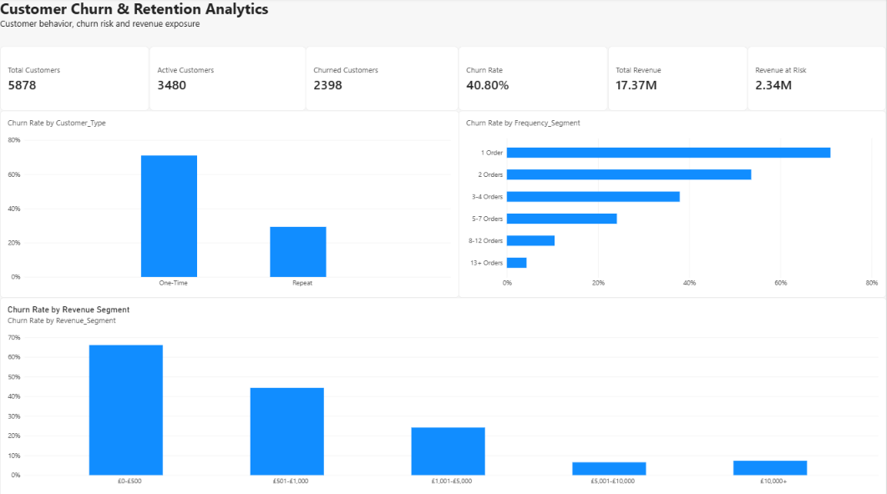
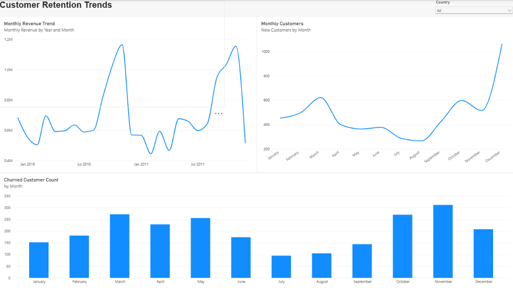
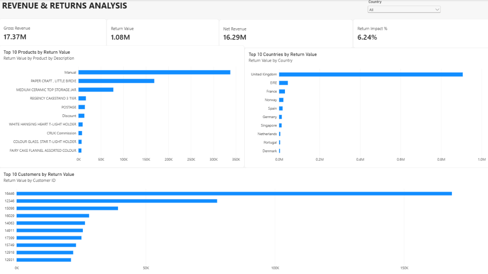

# Customer Churn & Retention Analytics

**End-to-end analysis of 2 years of UK online-retail transactions: who is leaving, how much revenue is at risk, and where returns are hurting the business.**

`Python` · `MySQL` · `Power BI` · `Excel`

---

## 1. Business Problem

An online gift-ware wholesaler sells to ~5,900 repeat and one-off business customers. Management sees healthy revenue but does not know:

- how many customers have **stopped buying**,
- **which customer groups** churn the most and which ones are worth saving,
- how much **revenue is exposed** to churn, and
- how much **cancellations and returns** eat into gross revenue.

This project answers those questions with a cleaned dataset, a SQL analysis layer, and a 3-page Power BI dashboard, and ends with recommendations a retention or CRM team could act on.

---

## 2. Dataset

| Item | Detail |
|---|---|
| Source | [Online Retail II](https://archive.ics.uci.edu/dataset/502/online+retail+ii) (UCI Machine Learning Repository) |
| Period | 01 Dec 2009 – 09 Dec 2011 (two Excel sheets: 2009-10 and 2010-11) |
| Raw size | 1,067,371 transaction lines, 8 columns, 43 countries |
| Columns | Invoice, StockCode, Description, Quantity, InvoiceDate, Price, Customer ID, Country |

---

## 3. Project Workflow

```
Raw Excel (2 sheets)
      │
      ▼
Python (pandas): inspect → clean → classify → feature engineering
      │
      ├── customer_purchases_clean.csv   (779,425 purchase lines)
      ├── cancellation_returns_clean.csv (18,390 return lines)
      └── customers.csv                  (5,878 customers, 17 features)
      │
      ▼
MySQL: 3 tables (customers, purchases, cancellation_returns) + 16 business-question queries
      │
      ▼
Power BI: 3-page dashboard (Executive overview · Retention trends · Revenue & returns)
```

---

## 4. Data Cleaning (Python)

All steps are in `notebooks/01_data_inspection.ipynb`.

| Step | Rows | Reason |
|---|---|---|
| Raw data (both sheets combined) | 1,067,371 | Starting point |
| Missing Customer ID | 243,007 | Churn is a customer-level measure; anonymous rows cannot be tracked |
| Cancellation invoices (start with `C`) / negative quantity | 19,494 / 22,950 | Separated into their own return table instead of being deleted |
| Zero or negative price | 6,202 / 5 | Samples, write-offs and adjustments, not real sales |
| Exact duplicate lines removed | 26,124 | Same invoice, product, quantity, price and timestamp |
| **Final purchase table** | **779,425** | 5,878 customers · 36,969 invoices · 4,631 products |
| **Final returns table** | **18,390** | 2,572 customers · duplicates (354) removed |

Other checks performed: outlier review (bulk orders up to 80,995 units), purchase-to-cancellation matching, and a revenue sanity check (`Revenue = Quantity × Price`).

**Result:** total clean purchase revenue **£17.37M**, return value **£1.08M**.

---

## 5. Feature Engineering and Churn Definition

One row per customer was built with: first/last purchase date, total orders, total items, total revenue, average order value, purchase frequency, recency, customer lifetime, and segments (recency band, frequency segment, revenue segment, one-time vs repeat).

**Churn definition: a customer is churned if they have not purchased in the last 180 days before the analysis date (09 Dec 2011).**

Why 180 days? It was chosen from the data, not guessed:

- Median gap between a repeat customer's purchases is 24 days and 90% of gaps are under ~135 days; the 95th percentile is 206 days.
- A threshold sensitivity test was run:

| Threshold | 60 d | 90 d | 120 d | **180 d** | 270 d | 365 d |
|---|---|---|---|---|---|---|
| Churn rate | 58.8% | 50.8% | 46.9% | **40.8%** | 32.7% | 27.2% |

180 days sits where most normal buying gaps have already passed, so it avoids labelling slow-but-active buyers as churned.

---

## 6. SQL Analysis (MySQL)

File: `sql/churn_analysis.sql`

- Schema design with primary and foreign keys (`customers` ← `purchases`, `customers` ← `cancellation_returns`)
- Bulk loading with `LOAD DATA LOCAL INFILE`, using a staging table for the returns file
- Data-quality checks (missing IDs, negative quantities, non-positive prices, date range, revenue reconciliation)
- 16 business questions answered with `GROUP BY`, `CASE WHEN`, subqueries, `HAVING` and date functions

---

## 7. Power BI Dashboard

File: `powerbi/churn_retention_analytics.pbix`

### Page 1: Executive Churn Overview


### Page 2: Customer Retention Trends


### Page 3: Revenue & Returns Analysis


---

## 8. Business Questions Answered

**Churn**
1. What is the overall churn rate and how many customers are active vs churned?
2. How do active and churned customers differ in revenue, orders, order value and recency?
3. Do one-time customers churn more than repeat customers?
4. How does purchase frequency affect churn?
5. Which revenue segments churn the most?

**Revenue at risk**
6. How much revenue sits with customers who have already churned?
7. Which high-value customers have churned (top 20 win-back list)?
8. Which countries carry the most churned revenue?

**Trends**
9. How many new customers are acquired each month?
10. How many customers churn each month?
11. Which countries have the highest churn rates (countries with 20+ customers)?
12. How does purchase frequency affect customer revenue (Pareto view)?

**Returns**
13. Which products generate the highest return value?
14. Which customers return the most?
15. Which countries return the most?
16. What is the financial impact of returns on gross revenue?

---

## 9. Key Findings

| # | Finding | Evidence |
|---|---|---|
| 1 | **40.8% of customers have churned** | 2,398 of 5,878 customers inactive for 180+ days |
| 2 | **The first-to-second order is the biggest leak** | One-time customers churn at **71.0%** vs **29.3%** for repeat customers; 1,152 of the 2,398 churned customers (48%) bought only once |
| 3 | **Churn falls steadily as orders increase** | 1 order: 71.0% → 2 orders: 53.6% → 3-4: 37.9% → 5-7: 24.1% → 8-12: 10.5% → 13+: 4.3% |
| 4 | **Low-value customers churn most** | £0-£500 segment churns at 66.1% vs 6.5-7.3% for the £5,000+ segments |
| 5 | **Revenue is highly concentrated** | Top 10% of customers = 63.9% of revenue; the 649 customers with 13+ orders = 58.8% of revenue |
| 6 | **£2.34M (13.4%) of revenue is tied to churned customers** | The £1,001-£5,000 segment holds the largest share of that (≈40%, ~£0.93M) |
| 7 | **44 churned customers each spent £5,000+** | Together £0.72M, a small, targetable win-back list |
| 8 | **Returns cost 6.24% of gross revenue** | £1.08M returned; net revenue £16.29M |
| 9 | **Two bulk cancellations drive ~23% of return value** | Customers 16446 and 12346 cancelled 80,995 and 74,215-unit orders within minutes (~£246K); these look like order errors, not product quality problems |
| 10 | **Strong Sep-Nov seasonality** | Monthly revenue peaks at ~£1.0-1.2M in Oct-Nov in both years vs ~£0.5-0.7M in other months |
| 11 | **The UK dominates** | 91% of customers and 83% of revenue; among countries with 20+ customers, Netherlands has the highest churn (72.7% on a small base of 22 high-spend customers) |

---

## 10. Recommendations

1. **Fix onboarding for first-time buyers.** Trigger a follow-up offer or reminder in the 30-60 days after the first order. Customers who place a second order roughly halve their churn risk, and a third order cuts it further.
2. **Run a targeted win-back campaign** on the 44 churned £5,000+ customers first, then the £1,001-£5,000 group, where the most recoverable revenue sits.
3. **Protect the 13+ order customers.** They are ~11% of customers but ~59% of revenue; monitor their recency and flag anyone approaching 90 days of silence before they hit the 180-day churn line.
4. **Add approval checks for very large orders** (e.g. 10,000+ units) and review why bulk orders are cancelled within minutes.
5. **Plan marketing, stock and staffing around Sep-Nov**, and use Jan-Feb for retention campaigns when demand is lowest.

---

## 11. Limitations and Assumptions

Being upfront about these is part of good analysis:

- **Churn is rule-based** (180 days of inactivity), not observed cancellation. This is a non-contractual retail business, so "churn" really means "likely lost".
- **Recency-band churn is 100% by construction** for bands above 180 days, so it is not a finding. The behavioural findings are frequency, customer type and revenue segment.
- **Anonymous sales are excluded.** 22.8% of raw rows have no Customer ID, so the results describe identified customers only.
- **Duplicate removal is a judgement call.** The 26,124 removed lines had identical fields, but some could be legitimate repeat scans in a wholesale order.
- **Return value includes non-product codes** (`Manual`, `POSTAGE`, `Discount`, `CRUK Commission`). "Manual" alone is £337K of the return value.
- **Edge effects in the monthly charts.** December 2011 is a partial month (data ends 9 Dec), which explains the sharp revenue drop at the end; "new customers" in Dec 2009 includes everyone already trading when the data starts.
- **Descriptive analysis only.** No predictive churn model was built (a natural next step).

---

## 12. Project Structure

```
customer-churn-retention-analytics/
│
├── raw_data/
│   └── online_retail_II.xlsx
├── cleaned_data/
│   ├── customer_purchases_clean.csv
│   ├── cancellation_returns_clean.csv
│   └── customers.csv
├── notebooks/
│   └── 01_data_inspection.ipynb
├── sql/
│   └── churn_analysis.sql
├── powerbi/
│   └── churn_retention_analytics.pbix
├── screenshots/
│   ├── executive-churn-overview.png
│   ├── customer-retention-trends.png
│   └── revenue-returns-analysis.png
└── README.md
```

---

## 13. How to Reproduce

1. **Python:** open the notebook, set `file_path` to the raw Excel file, and run all cells. It writes the three CSVs to `cleaned_data/`.
   `pip install pandas numpy matplotlib seaborn openpyxl`
2. **MySQL:** run `sql/churn_analysis.sql` top to bottom. Update the `LOAD DATA LOCAL INFILE` paths to your machine and make sure `local_infile` is enabled. Load `customers.csv` into `customers` first (the other tables reference it).
3. **Power BI:** open the `.pbix` file and refresh the data source paths to your local `cleaned_data/` folder.

---

## 14. Skills Demonstrated

- **Data cleaning and validation:** missing values, duplicates, cancellations, outliers, reconciliation
- **Feature engineering:** RFM-style metrics, segmentation, data-driven churn threshold
- **SQL:** schema design, joins, aggregation, subqueries, CASE logic, date functions
- **Dashboarding:** KPI cards, drill-down by country, executive-level storytelling in Power BI
- **Business thinking:** turning findings into specific, prioritised actions

---

## 15. Author

**Vikash Navik**: B.Sc. IT (SRMU, 2026), aspiring Data Analyst / Business Analyst
📧 *vikasnavik63@gmail.com* · 🔗 *www.linkedin.com/in/vikas-navik-160b61354* · 💻 *https://github.com/vikasnavik63*
